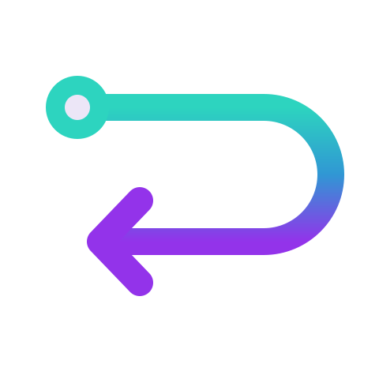

<p align="center"></p>

<h1 align="center">Backtrack</h1>

Backs up Docker Compose stacks with [restic](https://restic.net). Run one agent container on every Docker host. All
of them write to one shared restic repository, and one of them can also serve a web UI for the whole fleet.

- **Labels, not config files.** A stack is backed up when one of its containers has `backtrack.mode=stop` or
  `backtrack.mode=live`. Its data is `/opt/appdata/<project>` unless `backtrack.path` says otherwise.
- **Stacks keep their history when they move.** Each stack is its own restic series (`--host <stack>`), so moving
  a stack to another machine keeps its snapshots and its next backup stays incremental.
- **Restores that are hard to get wrong.** Before a restore in place, Backtrack takes a safety snapshot and keeps
  the old folder as `<stack>.pre-restore`. Owners and modes come back as they were. Paths you excluded from
  backups (like game worlds) stay where they were. The hub lists every folder a restore set aside and offers to
  remove it once the stack has stayed healthy, so they don't pile up.
- **Auto-restore for deploys.** Run `backtrack auto-restore <stack>` as a pre-deploy step: an empty or missing
  folder is filled from the latest snapshot. A stack with no snapshot starts fresh. An unreachable repository
  fails the deploy, so a stack never quietly starts empty.
- **Independent of your management plane.** Backtrack stops and starts containers through the Docker socket and
  keeps working while Komodo, Portainer or whatever deploys it is down. It can back up and restore that plane too.
- **Verified.** Every month each agent restores a random stack to scratch and compares it. The maintenance
  agent reads a twelfth of the repository's data with `restic check`.
- **Loud when it fails, quiet when it works.** Failures go to Discord and/or a JSON webhook. A heartbeat goes to
  Uptime Kuma (or any push URL) after every nightly run, so a run that never happens also alerts.

## How it fits together

```
          browser / dashboards / scripts
                       |
           agent with HUB=true  (UI, /api/v1, tokens)
                       |  signed calls (CLUSTER_KEY)
     +---------+-------+-------+---------+
   agent     agent           agent     agent      each: schedule, stop/start, backup, restore, alerts
     \_________ shared folder (NFS) _________/
        /share/restic      the restic repository
        /share/backtrack   presence files + maintenance lease
```

Agents never need the hub. It shows the fleet, starts backups and restores, and assigns the maintenance agent.
Agents find each other through presence files in the shared folder, so there is no peer list to maintain.

## Quick start

1. Make a shared folder every host can mount (NFS works well), and create the repository once:

   ```bash
   docker run --rm -e RESTIC_PASSWORD -v /mnt/nas/restic:/repo restic/restic:0.19.1 -r /repo init
   ```

2. Deploy [`examples/compose.yaml`](examples/compose.yaml) on every host, with `MACHINE` set to the host's name.
   On one host, use [`examples/compose.hub.yaml`](examples/compose.hub.yaml) instead.
3. Label the stacks you want backed up ([`examples/stack-labels.yaml`](examples/stack-labels.yaml)) and add a
   `.backupignore` to any stack folder that has caches or data you don't want backed up.
4. Optionally make each stack's pre-deploy step `docker exec backtrack backtrack auto-restore <stack>`.

## Labels

| Label | Meaning |
|---|---|
| `backtrack.mode=stop\|live` | Stop the project's containers around the backup (databases), or back up while running. |
| `backtrack.path=/abs/path` | The stack's data folder. Default `<APPDATA>/<project>`. |
| `backtrack.keep=daily=3,weekly=2` | Retention for this stack. Default `KEEP`. |
| `backtrack.hook.pre-stop=<url>` | POSTed before the stop, e.g. to silence alerts. A failed hook only warns. |
| `backtrack.hook.post-start=<url>` | POSTed after the containers start again. |
| `backtrack.post-restore=<command>` | Runs on the host (via a short-lived privileged helper) after a restore, before the stack starts. |

Named volumes aren't supported yet: keep stack data in bind-mounted folders.

## Settings

Set in the environment, or as `<NAME>_FILE` pointing at a file for secrets. A setting from the environment is
locked in the UI. The schedule and retention can be changed from the UI when the environment doesn't set
them, and are saved on that agent.

| Variable | Default | |
|---|---|---|
| `MACHINE` | required | This host's name. |
| `RESTIC_PASSWORD` | required | Repository password. |
| `RESTIC_REPOSITORY` | `/share/restic` | Any restic repository URL works. |
| `SHARE_DIR` | `/share/backtrack` | Presence files and the maintenance lease. |
| `APPDATA` | `/opt/appdata` | Default parent of stack folders. Mount it at the same path. |
| `STATE_DIR` | `/opt/appdata/backtrack` | Settings and job history. |
| `SCRATCH` | `/opt/cache/backtrack` | restic cache and restore tests. |
| `TZ` | `UTC` | Time zone for the schedule. |
| `BACKUP_SCHEDULE` | `04:00` | Nightly backups, one stack at a time. |
| `KEEP` | `daily=7,weekly=4,monthly=6` | Default retention. |
| `PRUNE_SCHEDULE` | `sun 13:00` | Weekly prune, maintenance agent only. |
| `VERIFY_SCHEDULE` | `1 14:00` | Monthly restore test and repository check. |
| `MAINTENANCE` | `false` | Claim the maintenance lease when no hub is assigning it. |
| `HUB` | `false` | Serve the UI and public API. |
| `AGENT_URL` | | How the hub reaches this agent. |
| `CLUSTER_KEY` | | Shared by all agents; signs hub-to-agent calls. |
| `UI_PASSWORD`, `READ_TOKEN`, `WRITE_TOKEN` | | Hub only. |
| `DISCORD_WEBHOOK_URL`, `ALERT_WEBHOOK_URL` | | Failure alerts. |
| `HEARTBEAT_URL` | | Called with `status=up\|down&msg=…` after every nightly run. |
| `HOOK_PRE_STOP_URL`, `HOOK_POST_START_URL` | | Stop hooks for every stack. |
| `PRERESTORE_SETTLE` | `5m` | How long a restored stack must stay running and healthy before its set-aside folder can be removed. |
| `PRERESTORE_AUTO_REMOVE` | off | e.g. `7d`: remove set-aside folders that old once their stack is healthy. Off means only on request. |

## Command line

```bash
docker exec backtrack backtrack list
docker exec backtrack backtrack backup myapp                 # --trigger pre-migrate before moving a stack
docker exec -it backtrack backtrack restore myapp            # --snapshot <id>; asks you to type the name
docker exec backtrack backtrack auto-restore myapp           # exit 0: restored, had data, or starts fresh
docker exec backtrack backtrack snapshots myapp
docker exec backtrack backtrack restore-test
docker exec backtrack backtrack prerestore list              # folders restores set aside, and whether they're safe
docker exec -it backtrack backtrack prerestore remove myapp  # removes the stack's safe ones; --path for one
```

Commands and the scheduler share a lock, so two jobs never run at once on one host.

## Moving a stack

1. In the hub, choose **Back up for migration** on the stack (or run `backup --trigger pre-migrate`). The stack
   starts again afterwards.
2. Stop or remove the stack on the old host using your management plane.
3. Deploy it on the new host. Auto-restore fills the folder from that backup. It refuses while the old host's
   agent still reports the stack running, so the stack never runs in two places with diverging data.

## API

`/api/v1` on the hub, with `Authorization: Bearer <READ_TOKEN|WRITE_TOKEN>`:
`GET /status`, `GET /agents`, `GET /stacks`, `GET /stacks/{stack}/snapshots`, `GET /jobs/{machine}/{id}`,
`POST /stacks/{stack}/backup` (`{"trigger":"manual"|"pre-migrate"}`) and
`POST /stacks/{stack}/restore` (`{"snapshot":"latest"|ID,"confirm":"<stack>"}`), `GET /prerestore` and
`POST /stacks/{stack}/prerestore/remove` (`{"path":"…","confirm":"<stack>"}`). `/healthz` needs no token.

## Development

```bash
python3 -m venv .venv && .venv/bin/pip install -e '.[test]'
.venv/bin/python -m pytest        # needs restic on PATH; ownership tests run only as root
```

Design notes are in [docs/design.md](docs/design.md). The logo is in [design/logo](design/logo): the mark
(also the UI's `static/mark.svg`), an icon on a dark circle (the UI's favicon), and square avatars (SVG and
PNG) for chat webhooks, which crop them round. MIT licensed; see `src/backtrack/static/NOTICE.md` for
the fonts, icons and design system that ship with the UI.
